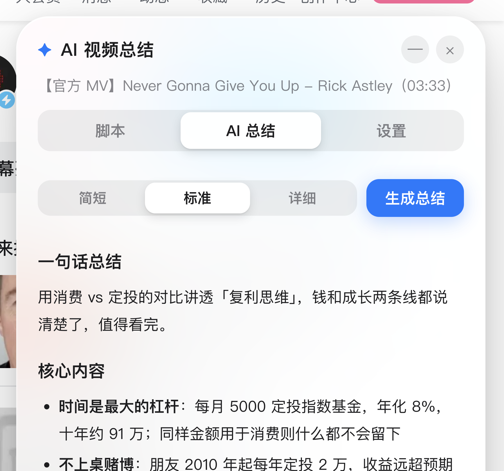
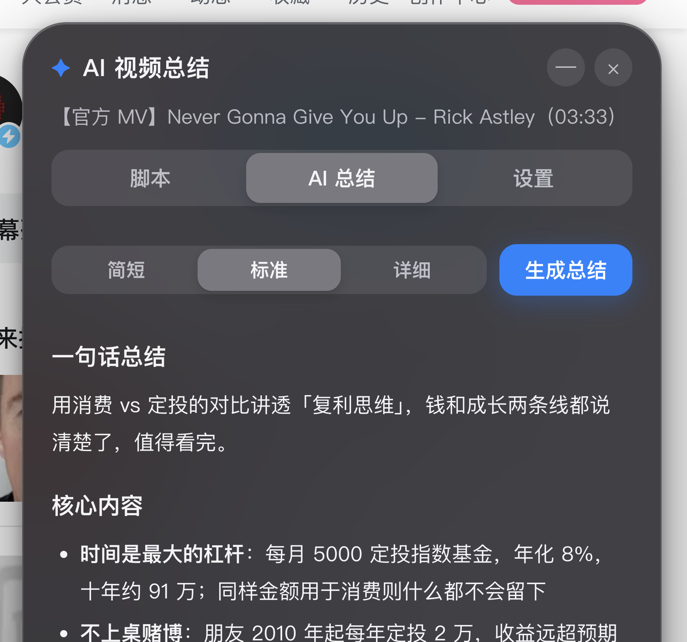

<div align="center">

# ✦ bilibili-summarizer

**B 站视频太长看不完？一键提取字幕脚本，AI 生成总结，长视频 3 分钟看懂全貌。**

`Chrome 扩展 (MV3)` · `iOS 液态玻璃 UI` · `总结长度三档可选` · `深浅色自适应` · `纯前端，无服务器`

<p>
  
  &nbsp;&nbsp;
  
</p>

</div>

---

## 这是什么

很多 B 站知识类视频有价值，但动辄三四十分钟。这个扩展会：

1. **提取视频字幕**，合并成带时间戳的脚本（点时间戳视频直接跳到那一秒，按需回看）；
2. **用你自己的 AI 接口生成总结**——简短的一段话、标准的要点式、详细的结构化笔记，三档长度随你选。

适合：收藏夹吃灰党、二倍速战士、想从视频里快速挖金句和数据的创作者。

## 功能

### 📜 字幕脚本
- 自动拉取视频的 AI 字幕 / CC 字幕，按语义合并成段落，段首带时间戳
- **点击时间戳，视频跳转到对应进度**——先看总结，再跳回感兴趣的片段精看
- 「复制全文」导出带时间戳的 Markdown 脚本，方便做笔记和二次创作
- 多 P 视频支持，切 P 自动刷新

### 🤖 AI 总结（长度可选）
面板里的分段控件切换三档，选择会记住：

| 档位 | 输出 |
| --- | --- |
| **简短** | 80~150 字一段话，10 秒判断这支视频讲什么、值不值得看完 |
| **标准** | 一句话总结 + 核心内容 + 值得回看的片段 + 金句摘录 |
| **详细** | 结构化笔记：内容脉络（按讲述顺序分节）+ 关键数据与案例 + 回看片段 + 金句 |

- 所有三档都要求 AI 带上视频里的**具体数据、案例、人名**，拒绝「讲了某种方法」式的空话
- 超长视频自动「分段小结 → 汇总成稿」，不怕字幕太长
- 流式输出，边生成边看

### 🎛 体验
- iOS 液态玻璃风格：毛玻璃材质、分段控件、按压缩放回弹
- 跟随系统深浅色模式自动切换
- 不依赖 B 站页面 DOM，悬浮按钮 + 独立面板，B 站改版不容易挂

## 安装

> 未上架 Chrome 商店，用开发者模式加载（一次性配置，之后自动更新本地代码）：

1. 下载本仓库（`git clone` 或 Download ZIP 解压），放到一个不会删的目录
2. Chrome 打开 `chrome://extensions/`，右上角打开「开发者模式」
3. 点「加载已解压的扩展程序」，选中本目录（有 `manifest.json` 的这一层）
4. 打开任意 B 站视频页，右侧出现「✦ AI 总结」悬浮按钮

## 配置 AI 接口（首次使用必做）

面板 → **设置** tab，填一次即可：

| 字段 | 说明 |
| --- | --- |
| 接口预设 | 智谱 GLM / DeepSeek / Kimi / 自定义，选自动填地址和模型 |
| 接口地址 | OpenAI 兼容的 Base URL |
| API Key | 对应平台控制台申请 |
| 模型 | 默认 `glm-4-flash`（智谱有免费额度，日常总结够用） |

任何 **OpenAI 兼容接口**都能接：智谱、DeepSeek、Kimi、通义、OpenAI、各家中转……想要更实的总结质量，把模型换成 `glm-4-plus` / `deepseek-chat` 这一级即可。

## 工作原理

```
B 站页面 ──→ 注入脚本读取页面数据（cid / 标题 / 分 P）
        ──→ 请求字幕接口（优先扩展后台，失败自动降级为页面身份请求）
        ──→ 下载字幕 JSON，按语义合并成带时间戳的段落
        ──→ 字幕文本发给「你自己填的」AI 接口，流式渲染总结
```

- 扩展跑在你自己的浏览器里，**复用你已有的 B 站登录态**获取 AI 字幕，不需要额外账号或 B 站开放平台凭证
- 纯前端，没有任何后端服务器

## 隐私

- **不收集任何数据**，没有埋点、没有统计、没有默认的服务端
- API Key 只存在浏览器的 `chrome.storage.sync` 里，随你自己的 Chrome 账号同步
- 字幕内容**只发送给你自己配置的 AI 接口**，扩展不经过任何第三方
- 对 B 站的请求全部来自你自己的浏览器和登录态

## 已知边界

- B 站的 **AI 字幕需要登录 B 站账号**后才有（浏览器没登录时会提示）
- 纯音乐、几乎无口播的视频没有字幕，无法总结
- 总结质量取决于你选的模型；提示词固定为「只依据字幕、不编造、带具体数据」
- 本扩展只读取字幕接口，不下载视频、不破解任何内容

## 用你自己写的脚本

本项目由 AI 结对开发（ZCode），代码结构简单，欢迎阅读、魔改、提 PR。

## 更新日志

- **2026-10-21 v0.2.0** 总结长度三档可选（简短 / 标准 / 详细，分段控件记住选择）；提示词强化「要点必须带数据案例」；UI 重做为 iOS 液态玻璃风格，深浅色自适应
- **2026-10-21 v0.1.0** 首版：字幕提取（时间戳可点跳转、复制全文导出）、AI 流式总结（长视频分段汇总）、多 P 支持、OpenAI 兼容接口预设

## License

[MIT](LICENSE)
